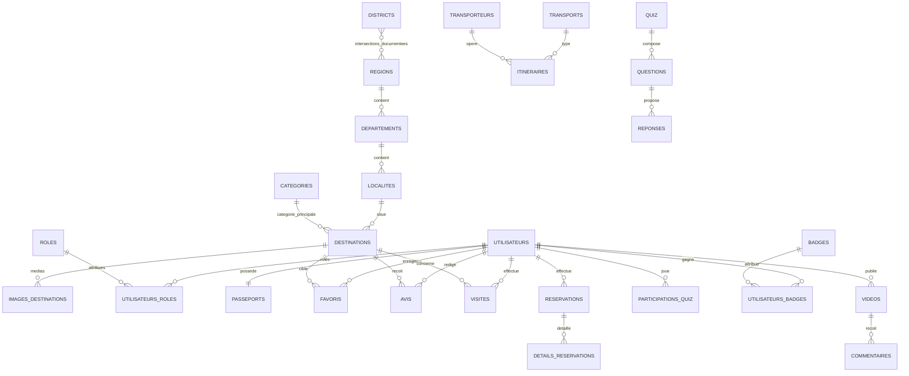

# Architecture relationnelle — Tourisme Ivoire

Proposition de structure MySQL 8 / InnoDB / utf8mb4. Les scripts SQL suivent ce modèle.

## Principes géographiques

Les deux districts autonomes et les 31 régions sont des référentiels distincts. La relation `districts_regions` permet d’enregistrer un rattachement uniquement lorsqu’il est documenté; les départements sont rattachés soit à une région, soit à un district, et les localités dépendent d’un département. Ne pas inventer d’intersection administrative pour compléter le jeu de données.

Une destination appartient à une localité et à une catégorie principale. Les catégories secondaires utilisent `destination_categories`. Coordonnées, horaires et tarifs non vérifiés restent NULL. Le contenu de démonstration porte `is_demo`; les mots de passe ne sont jamais stockés en clair.

## Diagramme

## Entités

- Comptes : `utilisateurs`, `roles`, `utilisateurs_roles`, `passeports`, `parametres_utilisateurs`.
- Territoire : `districts`, `regions`, `districts_regions`, `departements`, `localites`.
- Tourisme : `categories`, `destinations`, `destination_categories`, `images_destinations`, `horaires_destinations`, `avis`, `favoris`, `visites`.
- Mobilité : `transports`, `transporteurs`, `itineraires`, `reservations`, `details_reservations`.
- Communauté : `videos`, `commentaires`, `likes`, `abonnements`, `signalements`.
- Quiz : `quiz`, `questions`, `reponses`, `participations_quiz`, `badges`, `utilisateurs_badges`, `historique_points`.
- Patrimoine : `patrimoines`, `visites_virtuelles`, `medias_patrimoine`, `traductions`.
- Application : `notifications`, `parametres_utilisateurs`, `historique_recherches`, `langues`, `contenus_hors_ligne`.

Les tables utilisent des PK BIGINT, FK explicites, index sur les FK et champs de recherche, timestamps, statuts et suppression logique lorsque l'historique doit être conservé. Les associations portent des contraintes d'unicité pour éviter les doublons. Les cibles polymorphes (traductions, signalements, contenus hors ligne) sont validées par le service applicatif.

## Décisions validées

- Géographie : conserver districts et régions distincts, avec une relation explicite et documentée entre eux lorsque la source officielle l’atteste.
- Réservations = demandes sans paiement au premier jalon.
- Les images sont livrées avec crédits/licences; aucune image non autorisée ni URL fictive ne sera injectée.
- Score de passeport maintenu par historique des points avec total stocké comme cache recalculable.
- Les 10 quiz, questions/réponses et données fictives restent identifiés comme démonstration.
- Les données administratives doivent provenir d’une publication officielle; les codes non présents et les coordonnées non vérifiées restent NULL.
